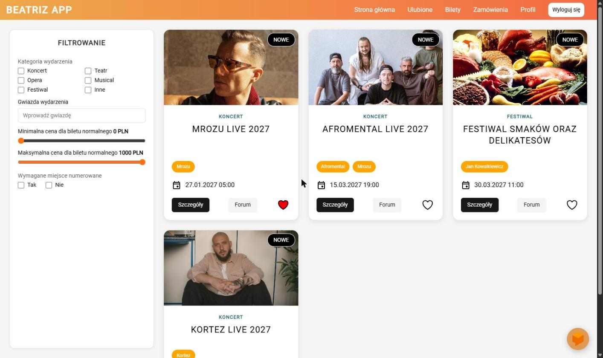
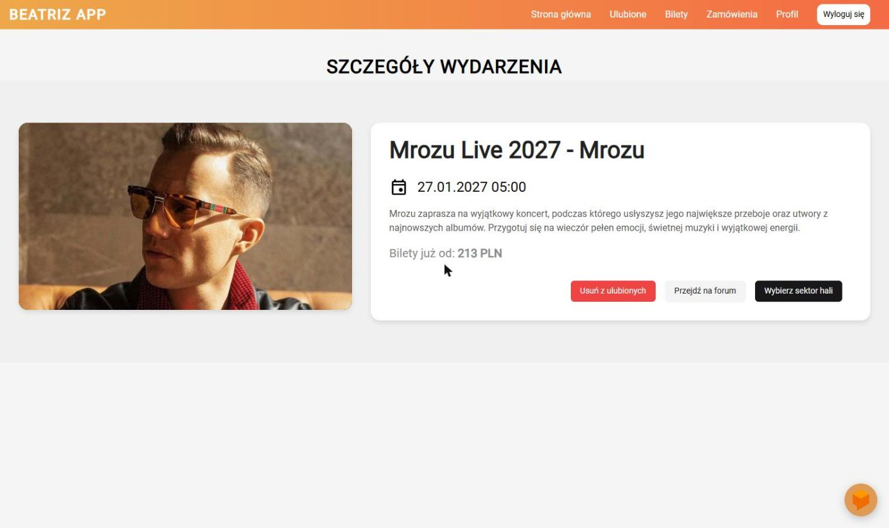
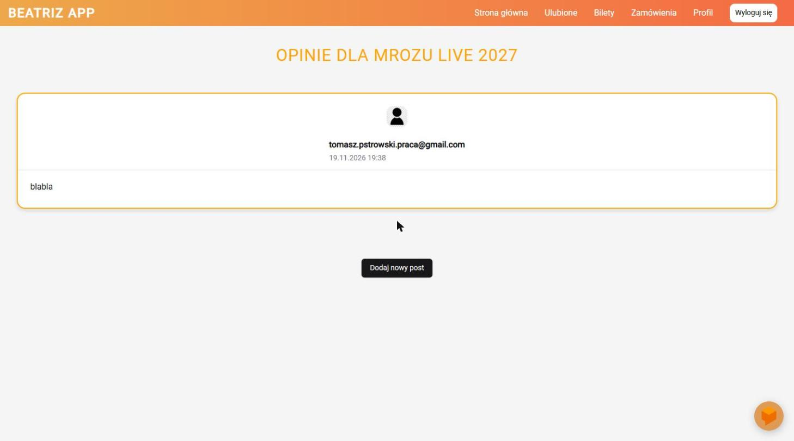
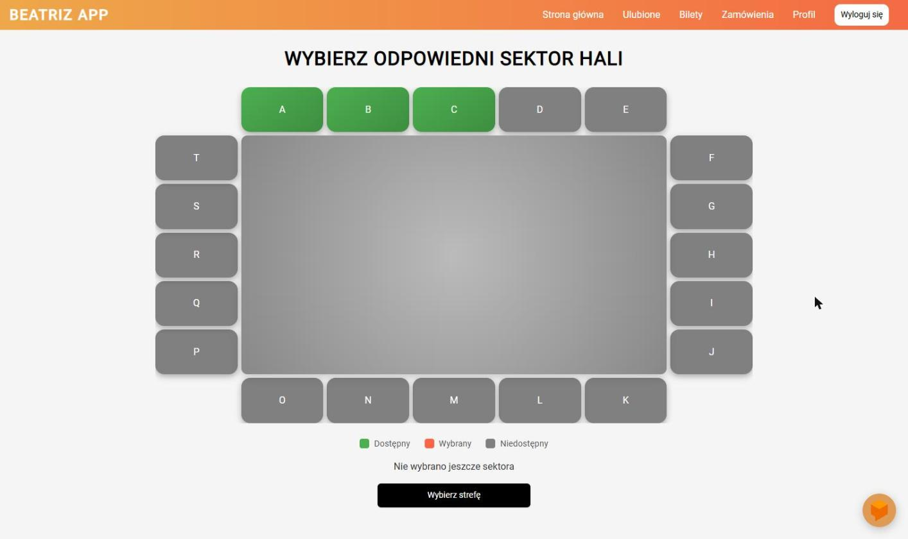
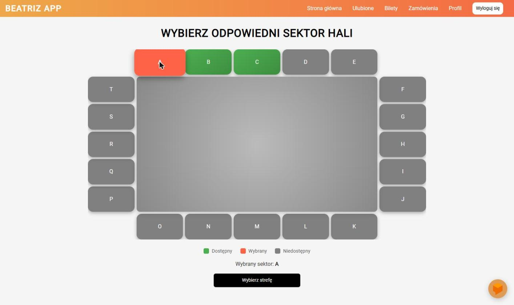
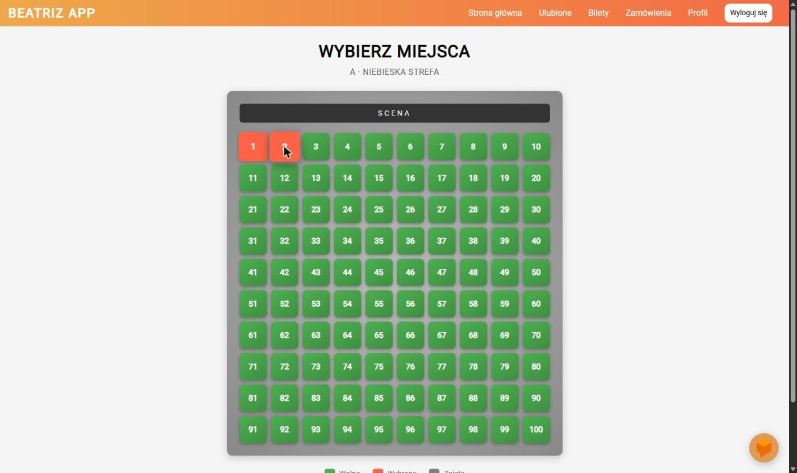
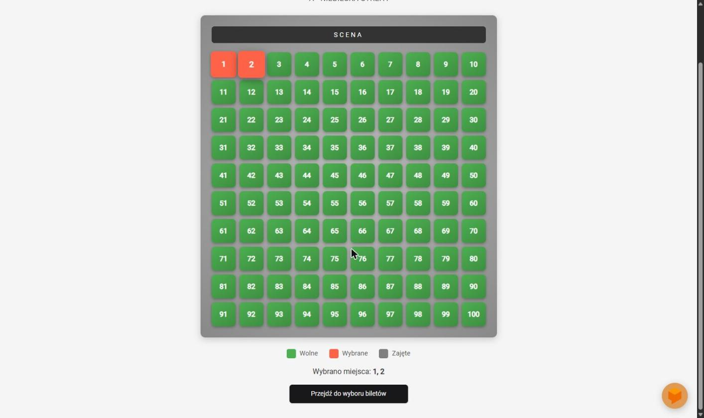
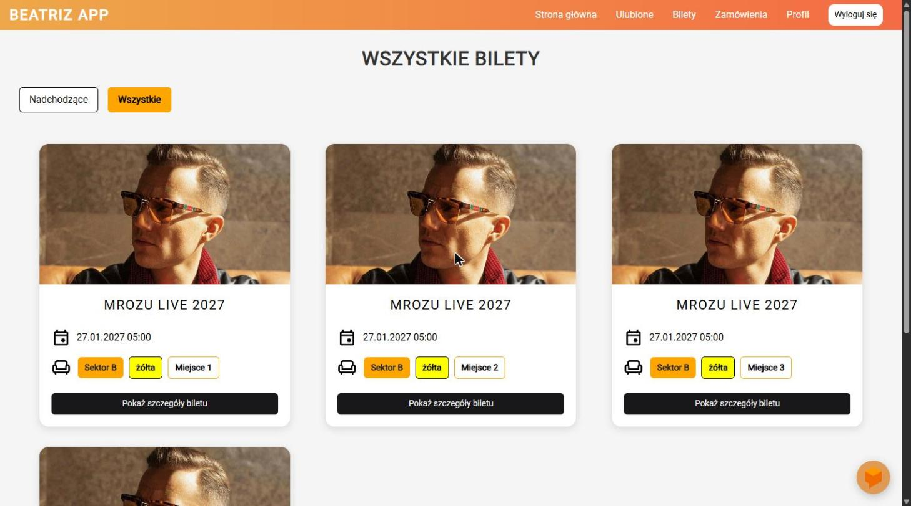
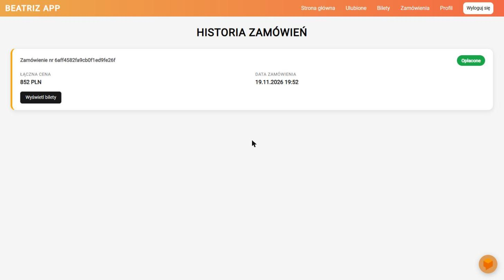

# Beatriz App — Event Ticket Booking System

An event ticket booking application with Stripe payments, discount codes, forums and user profiles.

## Architecture

The project is a **monorepo** managed with npm workspaces and consists of three modules:

| Module | Description |
|--------|-------------|
| `shared/` | Shared TypeScript types, Mongoose schemas, enums and constants |
| `backend/` | API server (Express + Mongoose + Stripe) |
| `frontend/` | Client application (React + Vite + TypeScript) |

## Quick Start

### Requirements

- **Node.js** 22.18+ (the backend runs TypeScript natively, without compilation or Babel)
- **MongoDB** — a local instance or MongoDB Atlas
- **Stripe** — an account and API keys

### Installation

```bash
npm install
```

This installs the dependencies of all three modules at once (thanks to npm workspaces).

### Configuration

#### Backend — `backend/.env.local` (template: `backend/.env.example`)

```
DATABASE=mongodb://localhost:27017/beatriz
DATABASE_PASSWORD=your_password
NODE_ENV=development
PORT=3000
JWT_SECRET=your_jwt_secret
JWT_EXPIRES_IN=7d
STRIPE_SK=sk_test_...
STRIPE_ENDPOINT_SECRET=whsec_...
MAIL_USERNAME=your_email@gmail.com
MAIL_PASSWORD=your_app_password
MAIL_HOST=smtp.gmail.com
MAIL_PORT=587
GOOGLE_MAIL_USERNAME=your_email@gmail.com
GOOGLE_MAIL_PASSWORD=your_app_password
```

#### Frontend — `frontend/.env`

```
VITE_GOOGLE_CLIENT_ID=your_google_client_id
VITE_FACEBOOK_APP_ID=your_facebook_app_id
```

### Running the App

```bash
# Start the backend (port 3000)
npm run dev:backend

# Start the frontend (port 5173)
npm run dev:frontend
```

The frontend will be available at `http://localhost:5173`.

### Stripe Webhook (development mode)

```bash
stripe login
stripe listen --forward-to localhost:3000/api/v2/webhooks/stripe
```

## Project Structure

```
beatriz-app/
├── backend/          # API server (Express)
│   ├── modules/      # Domain modules (routes, controller, service, model, mapper, types)
│   ├── utils/        # Helper functions
│   └── tests/        # Unit tests
├── frontend/         # React application
│   └── src/
│       ├── app/      # App startup, routes and layout
│       ├── features/ # App features (api, components, pages, context, utils)
│       └── shared/   # Shared code
├── shared/           # Shared module
│   ├── types/        # TypeScript types
│   ├── schemas/      # Mongoose schemas
│   ├── enums/        # Enums
│   └── constants/    # Constants
└── package.json      # Monorepo (npm workspaces)
```

## Key Technologies

- **Backend**: Express, Mongoose, Stripe, JWT, Nodemailer, Swagger
- **Frontend**: React 18, Vite, TypeScript, TanStack Query, React Router, Mantine, Shadcn/ui, TailwindCSS
- **Shared**: Mongoose (schemas), bcryptjs, validator

## Screenshots

### Events

| Home page | Event details |
|:---:|:---:|
|  |  |

| Forum | |
|:---:|:---:|
|  | |

### Buying tickets

| 1. Choose a sector | 2. Sector A selected |
|:---:|:---:|
|  |  |

| 3. Choose a zone | 4. Blue zone selected |
|:---:|:---:|
|  |  |

| 5. Choose seats | 6. Seats 1 and 2 selected |
|:---:|:---:|
|  |  |

| 7. Go to tickets | 8. Choose ticket types |
|:---:|:---:|
|  |  |

| 9. Order summary | |
|:---:|:---:|
|  | |

### User account

| Favourites | Tickets |
|:---:|:---:|
|  |  |

| Order history | |
|:---:|:---:|
|  | |

## Ticket Purchase Process

The full data flow, from the home page to purchased tickets, is described in:

- **Frontend**: `frontend/README.md` — the purchase process step by step
- **Backend**: `backend/README.md` — endpoints and the payment flow

---

More details are available in each module's README: [`shared/`](./shared/README.md), [`backend/`](./backend/README.md), [`frontend/`](./frontend/README.md).
