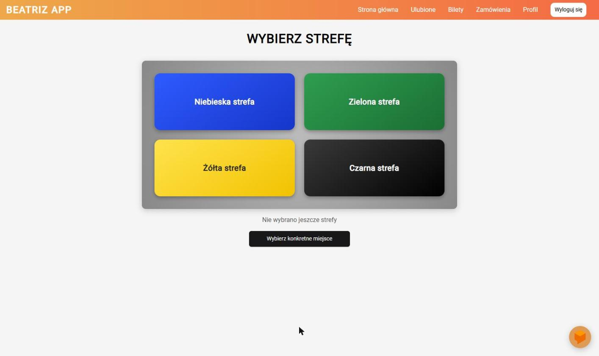
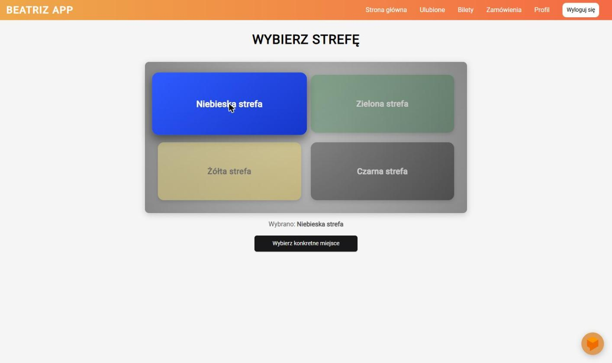
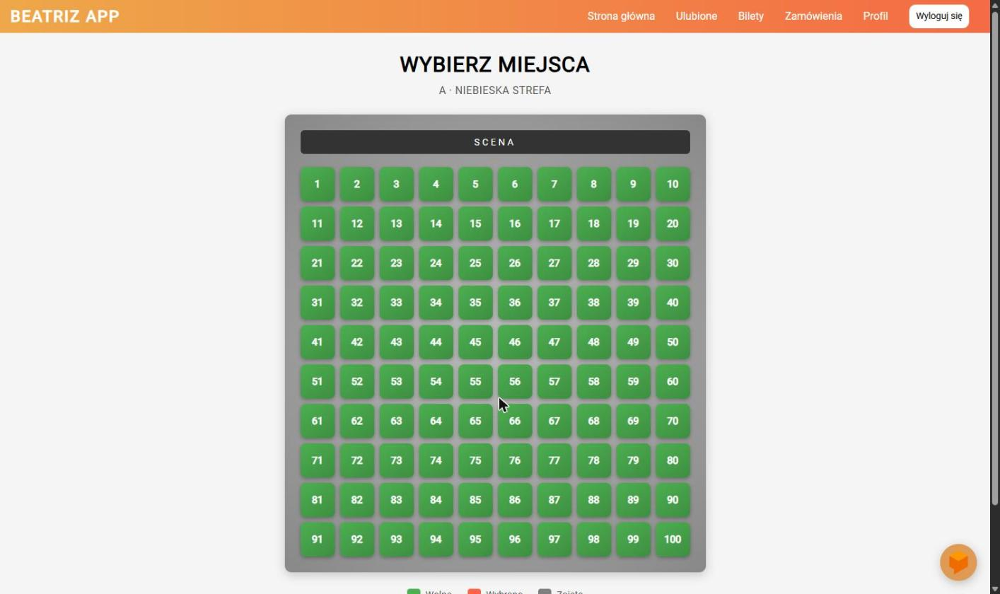
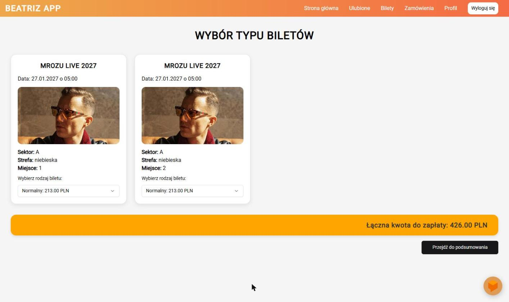
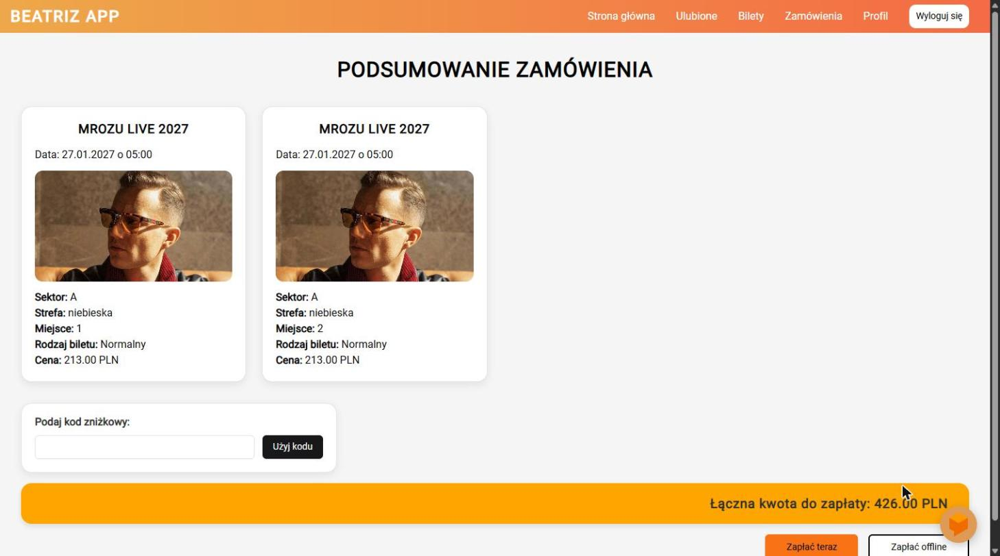
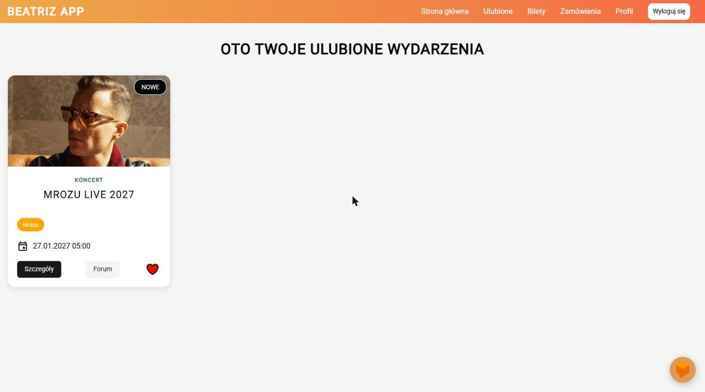

# Beatriz App — Event Ticket Booking System

An event ticket booking application with Stripe payments, discount codes, forums and user profiles.

## Architecture

The project is a **monorepo** managed with npm workspaces and consists of three modules:

| Module      | Description                                                    |
| ----------- | -------------------------------------------------------------- |
| `shared/`   | Shared TypeScript types, Mongoose schemas, enums and constants |
| `backend/`  | API server (Express + Mongoose + Stripe)                       |
| `frontend/` | Client application (React + Vite + TypeScript)                 |

## Quick Start

### Requirements

-   **Node.js** 22.18+ (the backend runs TypeScript natively, without compilation or Babel)
-   **MongoDB** — a local instance or MongoDB Atlas
-   **Stripe** — an account and API keys

### Installation

```bash
npm install
```

This installs the dependencies of all three modules at once (thanks to npm workspaces).

### Configuration

#### Backend — `backend/.env.local` (template: `backend/.env.example`)

```
DATABASE=mongodb://localhost:27017/beatriz
DATABASE_PASSWORD=your_password
NODE_ENV=development
PORT=3000
JWT_SECRET=your_jwt_secret
JWT_EXPIRES_IN=7d
STRIPE_SK=sk_test_...
STRIPE_ENDPOINT_SECRET=whsec_...
MAIL_USERNAME=your_email@gmail.com
MAIL_PASSWORD=your_app_password
MAIL_HOST=smtp.gmail.com
MAIL_PORT=587
GOOGLE_MAIL_USERNAME=your_email@gmail.com
GOOGLE_MAIL_PASSWORD=your_app_password
```

#### Frontend — `frontend/.env`

```
VITE_GOOGLE_CLIENT_ID=your_google_client_id
VITE_FACEBOOK_APP_ID=your_facebook_app_id
```

### Running the App

```bash
# Start the backend (port 3000)
npm run dev:backend

# Start the frontend (port 5173)
npm run dev:frontend
```

The frontend will be available at `http://localhost:5173`.

### API Documentation (Swagger)

With the backend running, open **<http://localhost:3000/api-docs>**. Every endpoint is documented there and can be called straight from the browser with **Try it out** (request bodies come with ready-to-send examples). To call protected endpoints, log in with `POST /api/v2/auth/login`, copy `data.accessToken` from the response and paste it into **Authorize**. See [`backend/README.md`](./backend/README.md#api-documentation-swagger) for details.

### Stripe Webhook (development mode)

```bash
stripe login
stripe listen --forward-to localhost:3000/api/v2/webhooks/stripe
```

## Tests and Coverage

```bash
# From the project root: backend and frontend together, each with its own config
npm test                # runs all unit tests
npm run test:coverage   # coverage reports for both (HTML in backend/coverage/ and frontend/coverage/)

# Or from backend/ or frontend/ for just one of them
npm test
npm run test:coverage
```

The root `vitest.workspace.ts` makes `npx vitest run` from the root load `backend/vitest.config.ts` and `frontend/vite.config.ts`, so tests can be started from any folder.

| Module                                    | Tests | Lines | Branches | Functions |
| ----------------------------------------- | ----: | ----: | -------: | --------: |
| Backend (Vitest)                          |   309 | 50.9% |    90.7% |     77.3% |
| Frontend (Vitest + Testing Library + MSW) |   134 | 28.7% |    77.8% |     57.7% |

Coverage as of November 2026. The business logic is well covered (all backend services 100%, backend utils 84%, frontend utils and API client 95–100%); the gaps are the Express controllers and routes, which need integration tests, and frontend pages that do not have tests yet. Per-module numbers are in [`backend/README.md`](./backend/README.md#tests) and [`frontend/README.md`](./frontend/README.md#tests).

## Project Structure

```
beatriz-app/
├── backend/          # API server (Express)
│   ├── modules/      # Domain modules (routes, controller, service, model, mapper, types)
│   ├── utils/        # Helper functions
│   └── tests/        # Unit tests
├── frontend/         # React application
│   └── src/
│       ├── app/      # App startup, routes and layout
│       ├── features/ # App features (api, components, pages, context, utils)
│       └── shared/   # Shared code
├── shared/           # Shared module
│   ├── types/        # TypeScript types
│   ├── schemas/      # Mongoose schemas
│   ├── enums/        # Enums
│   └── constants/    # Constants
└── package.json      # Monorepo (npm workspaces)
```

## Key Technologies

-   **Backend**: Express, Mongoose, Stripe, JWT, Nodemailer, Swagger
-   **Frontend**: React 18, Vite, TypeScript, TanStack Query, React Router, Mantine, Shadcn/ui, TailwindCSS
-   **Shared**: Mongoose (schemas), bcryptjs, validator

## Screenshots

### Events

|                                        Home page                                        |                                Event details                                 |
| :-------------------------------------------------------------------------------------: | :--------------------------------------------------------------------------: |
|  |  |

### Buying tickets

|                                       1. Choose a sector                                       |                                     2. Sector A selected                                      |
| :--------------------------------------------------------------------------------------------: | :-------------------------------------------------------------------------------------------: |
|  |  |

|                                   3. Choose a zone                                    |                                      4. Blue zone selected                                      |
| :-----------------------------------------------------------------------------------: | :---------------------------------------------------------------------------------------------: |
|  |  |

|                                    5. Choose seats                                    |                                      6. Seats 1 and 2 selected                                      |
| :-----------------------------------------------------------------------------------: | :-------------------------------------------------------------------------------------------------: |
|  |  |

|                                         7. Go to tickets                                          |                                       8. Choose ticket types                                        |
| :-----------------------------------------------------------------------------------------------: | :-------------------------------------------------------------------------------------------------: |
|  |  |

|                                   9. Order summary                                    |     |
| :-----------------------------------------------------------------------------------: | :-: |
|  |     |

### User account

|                                  Favourites                                  |                                  Tickets                                   |
| :--------------------------------------------------------------------------: | :------------------------------------------------------------------------: |
|  |  |

|                                Order history                                 |     |
| :--------------------------------------------------------------------------: | :-: |
|  |     |

## Ticket Purchase Process

The full data flow, from the home page to purchased tickets, is described in:

-   **Frontend**: `frontend/README.md` — the purchase process step by step
-   **Backend**: `backend/README.md` — endpoints and the payment flow

---

More details are available in each module's README: [`shared/`](./shared/README.md), [`backend/`](./backend/README.md), [`frontend/`](./frontend/README.md).
